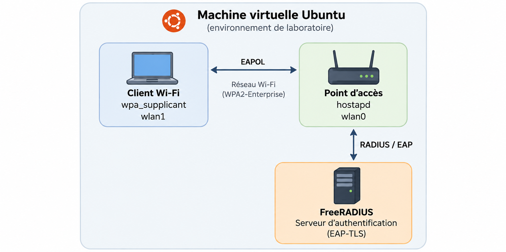

# Sécurisation d'un réseau Wi-Fi d'entreprise — WPA2-Enterprise / EAP-TLS

## Présentation du projet

Ce projet académique porte sur la conception et la mise en œuvre d'une infrastructure Wi-Fi sécurisée utilisant **WPA2-Enterprise**, le protocole **IEEE 802.1X** et l'authentification **EAP-TLS** basée sur des certificats numériques.

L'objectif est de comprendre et de mettre en pratique les mécanismes d'authentification d'un réseau sans fil d'entreprise, puis d'analyser les échanges entre le client, le point d'accès et le serveur RADIUS.

## Objectifs techniques

- Comprendre la différence entre WPA2-Personal (PSK) et WPA2-Enterprise.
- Mettre en place une authentification centralisée avec FreeRADIUS.
- Configurer un point d'accès utilisant IEEE 802.1X.
- Configurer un client Wi-Fi utilisant EAP-TLS.
- Étudier l'utilisation des certificats numériques pour l'authentification mutuelle.
- Observer les échanges EAPOL, EAP-TLS et la négociation des clés avec Wireshark.
- Identifier et résoudre les problèmes de configuration et de connectivité.

## Architecture du laboratoire



Le laboratoire repose sur une machine virtuelle Ubuntu hébergeant les différents composants du réseau Wi-Fi.

| Composant | Technologie | Fonction |
|---|---|---|
| Système | Ubuntu Linux | Environnement du laboratoire |
| Point d'accès | hostapd | Authenticator 802.1X |
| Serveur d'authentification | FreeRADIUS | Validation des identités et certificats |
| Client Wi-Fi | wpa_supplicant | Supplicant 802.1X |
| Interfaces sans fil | mac80211_hwsim | Simulation des interfaces Wi-Fi |
| Analyse réseau | Wireshark | Capture et analyse des échanges |

### Fonctionnement général

1. Le client Wi-Fi demande à rejoindre le réseau sécurisé.
2. Le point d'accès déclenche le processus d'authentification IEEE 802.1X.
3. Les messages EAP sont transportés entre le client et le serveur FreeRADIUS par l'intermédiaire du point d'accès.
4. Le protocole EAP-TLS permet l'authentification mutuelle à l'aide de certificats numériques.
5. Après une authentification réussie, le client et le point d'accès procèdent à l'établissement des clés de chiffrement de la session Wi-Fi.

## Mise en œuvre technique

### 1. Préparation de l'environnement Linux

- Préparation de la machine virtuelle Ubuntu.
- Installation des composants nécessaires au laboratoire.
- Création d'interfaces Wi-Fi virtuelles avec `mac80211_hwsim`.
- Gestion des interfaces réseau avec les outils Linux.

### 2. Configuration du point d'accès

- Configuration de `hostapd`.
- Activation du mode WPA2-Enterprise.
- Configuration des paramètres IEEE 802.1X.
- Intégration avec le serveur RADIUS.

### 3. Configuration du serveur FreeRADIUS

- Préparation du service d'authentification RADIUS.
- Configuration de la méthode EAP-TLS.
- Utilisation des certificats nécessaires à l'authentification.
- Analyse des journaux et diagnostic avec le mode débogage.

### 4. Configuration du client Wi-Fi

- Configuration de `wpa_supplicant`.
- Définition de la méthode d'authentification EAP-TLS.
- Référencement du certificat de l'autorité de certification, du certificat client et de la clé privée.
- Analyse du processus de connexion.

### 5. Analyse et dépannage

- Observation des messages EAPOL.
- Étude des échanges EAP-TLS.
- Analyse du processus de négociation des clés WPA2.
- Vérification des configurations et des journaux des services.
- Dépannage des problèmes rencontrés pendant le déploiement.

## Commandes et outils de diagnostic

Exemples de commandes utilisées dans le laboratoire :

```bash
# Vérifier les interfaces Wi-Fi
iw dev

# Vérifier les interfaces réseau
ip link show

# Exécuter FreeRADIUS en mode débogage
sudo freeradius -X

# Exécuter hostapd en mode débogage
sudo hostapd -dd hostapd-eap.conf

# Exécuter le client Wi-Fi en mode débogage
sudo wpa_supplicant -i wlan1 -c wpa_supplicant-eap-tls.conf -dd
```

## Compétences démontrées

- Sécurité des réseaux sans fil
- WPA2-Enterprise et IEEE 802.1X
- Authentification EAP-TLS
- Infrastructure RADIUS
- Gestion des certificats numériques
- Administration Linux
- Analyse de protocoles avec Wireshark
- Diagnostic et résolution d'incidents réseau
- Virtualisation et simulation d'infrastructures

## Documentation et preuves techniques

Le dépôt sera enrichi progressivement avec :

- Un schéma de l'architecture du laboratoire.
- Des exemples de fichiers de configuration anonymisés.
- Des captures d'écran des services et des tests.
- Des captures Wireshark illustrant les échanges d'authentification.
- Une documentation des difficultés rencontrées et des solutions appliquées.

**Note de sécurité :** aucune clé privée, aucun secret RADIUS ni aucun identifiant sensible ne sera publié.

---

**Contexte :** Projet académique en gestion de réseaux et sécurité — Collège LaSalle, Montréal.

**Technologies :** Ubuntu, hostapd, FreeRADIUS, wpa_supplicant, IEEE 802.1X, WPA2-Enterprise, EAP-TLS, Wireshark.
